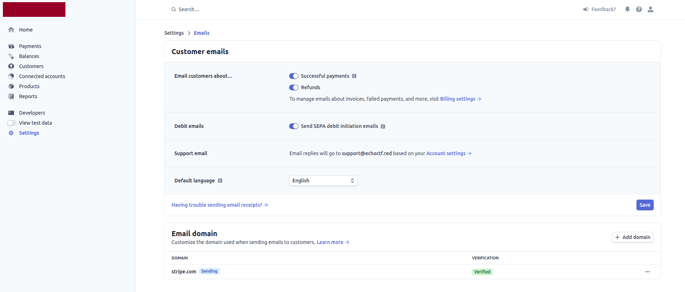

# echoCTF Stripe support

## Preparing Stripe

We assume you have a stripe account already configured for your business.

### 1. Create products

- Go to Products -> Create <https://dashboard.stripe.com/test/products/create>
- Fill in the following details
  - Name / Description
  - Additional Options -> Add metadata
    - `network_ids`: Coma seperated list of network IDs that this subscription will provide access to
    - `badge_id`: ID of the badge to assign to user
    - `spins`: Number of spins the user will get
    - `max_target_instances`: Number of concurrent private target instances (each for a different target) the subscriber can have. Overrides the `max_target_instances` sysconfig key while the subscription is active
    - `shortcode`: Network shortcode
    - `weight`: users by ordering
    - `perks`: raw html of the perks the subscription provides
    - `vpn_ip_limit`: Number of players that can be connected to the VPN from the same IP address while the owner of this subscription is connected. Only used when the `vpn_ip_limit` sysconfig key is enabled, the highest value of all the players connected from an IP applies to all of them
    - `api_bearer_enable`: 0/1 Wheather the subscription includes enables API access to the frontend for the players
    - `standalone_perk`: (optional) 0/1 if this is a stand-alone perk (non-recurring)
    - `days`: If this is a stand-alone product but needs to stay active for a number of days (non-recurring) The duration is handled by the platform and not Stripe.
    - `htmlOptions`: jsonEncoded Options to be used by the UI
      - `title`: title to show on frontend
      - `class`: css classes to add to the product card
- Create prices for the products
- Choose if the payment will bn reccuring (eg. subscription based) or flat rate
- Optionally add metadata for non recurring one-time payments
  - `days`: number of days this will be active
  - `perk`: 0/1 if this is a perk
  - `spins`: 0 reset, any other number increase player daily limit by number
  - `notification_body`: Notification details to be send to the user (overloads product details if present)
  - `notification_title`: Notification details to be send to the user (overloads product details if present)
  - `notification_type`: Notification details to be send to the user (overloads product details if present)
  - `machines`: Number of machines this involves

### 2. Configure customer portal

- Go to Settings -> Customer portal <https://dashboard.stripe.com/test/settings/billing/portal>
- Set the following options:
  - Allow customers to view their invoice history
  - Allow customer to update the following billing information
    - Email, Billing Address, Tax ID
  - Allow customers to update their payment methods
  - Allow customers to switch to a different pricing plan
  - Allow customers to update subscription quantities
  - Prorate subscription updates: Issue invoice immediately
  - Products: add existing products and add restrictions to _Limit quantity to 1_
  - Business Information details

### 3. Configure automatic emails on purchases

- Go to <https://dashboard.stripe.com/settings/emails>
- Set the following details on **Customer emails**:
  - Email customers about… enable
    - Successful payments
    - Refunds

## Backed Sales Module

The backend provides visibility to the Stripe data through the sales module. The details provided are

1. Customers
2. Subscriptions
3. Products
4. Prices
5. Product Networks
6. Webhook

### Testing

1. Enable testing mode on your stripe dashboard and copy the details
2. Install Stripe Shell (<https://github.com/stripe/stripe-cli/releases/latest>)
3. Set your testing keys
   - `stripe_publicApiKey`: `pk_test_STRIPE_PUBLIC_KEY`
   - `stripe_apiKey`: `sk_test_STRIPE_DEV_API_KEY`
   - `stripe_webhookSecret`: `whsec_STRIPE_DEV_SECRET`
4. Login using stripe `stripe login --api-key sk_test_STRIPE_DEV_API_KEY`
5. Listen for event and forward to your local webhooks url `stripe listen --forward-to localhost:8082/subscription/secreturl/webhook`

## Frontend Subscriptions Module

For the frontend the subscriptions module handles the Stripe related operations.
Currently the following webhook types are used

- `customer.subscription.updated`
- `customer.deleted`
- `customer.created`
- `customer.subscription.deleted`
- _`invoice.payment_failed`_ currently disabled
- _`checkout.session.completed`_ currently disabled
- _`invoice.paid`_ currently disabled

### Testing:

- Go to ngrok URL
- Login with your credentials
- Go to networks
- Click on subscribe
- Pick a subscription
- Provide the following credit card details
  - CC number 4242 4242 4242 4242
  - expiration: Any date in the future
  - CC verification code: any number

You are now redirected to the echoCTF site with a button about your billing details. Clicking that takes you to stripe and from there back to your profile.

Your profile now also has a button that redirects you to your stripe customer
portal where you can download invoices or upgrade/downgrade or cancel your
existing subscriptions.
